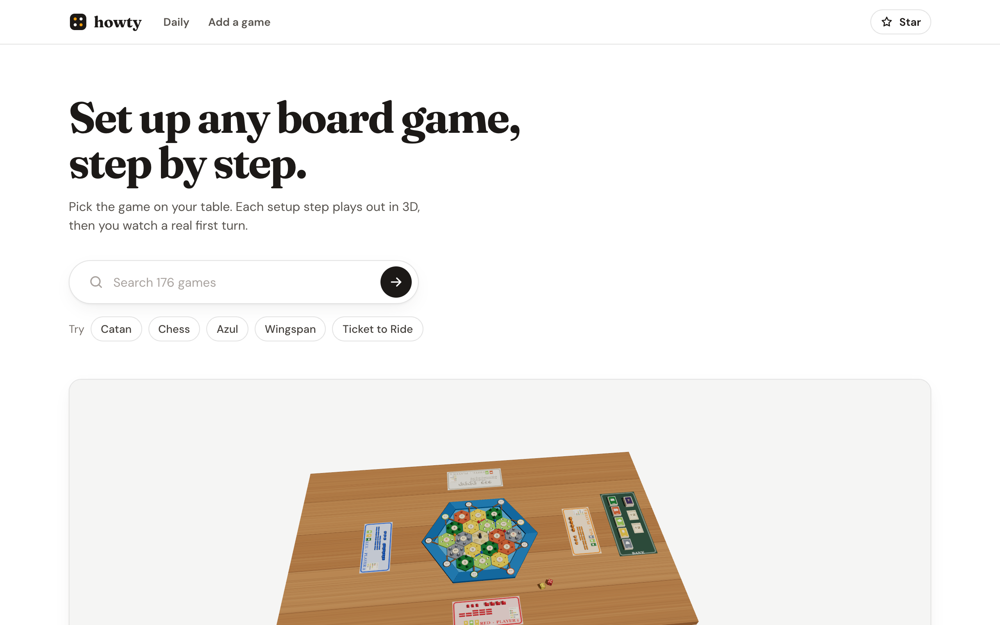
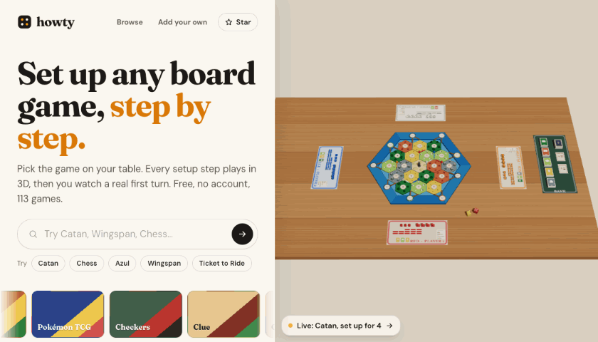
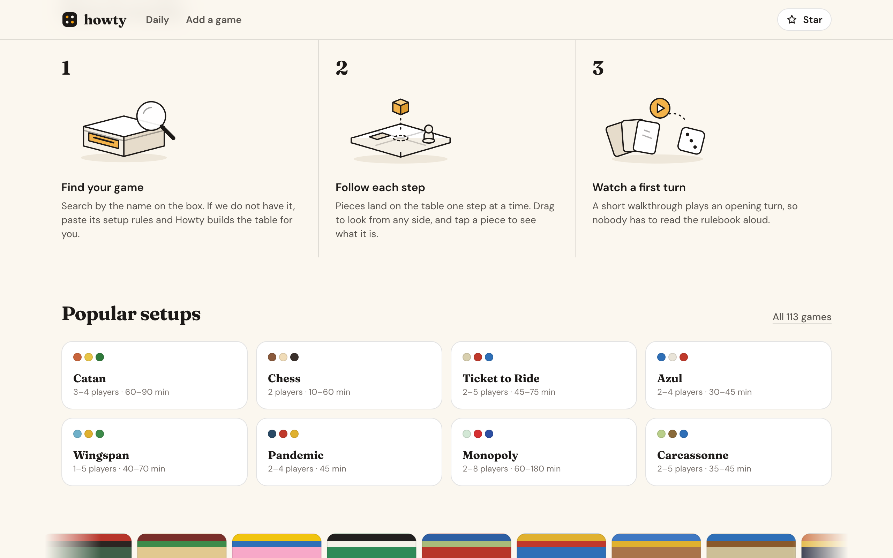

# Howty

**Set up any board game, step by step.** Pick the game on your table and Howty places every
piece on a 3D table one step at a time, then plays a short first turn. 176 games, free, no account.

**Try it: [howty.vercel.app](https://howty.vercel.app)**

- **Runs entirely in the browser.** No backend, no API keys, no AI calls, no tracking. It is a static site.
- **176 games built in**, from Chess and Catan to Wingspan and Terraforming Mars, plus 63 card games: Hearts, Solitaire, Blackjack and 18 kinds of poker among them.
- **Add your own.** Paste the setup section of any rulebook and get a 3D table. Share it with a link:
  the rules travel in the link itself, so nothing is uploaded.
- **Hands-free.** Optional narration and "next / back / repeat" voice commands (where the browser supports them).
- **Daily table.** A finished setup with the name hidden: one guess, a new table every day, a streak, and a
  result you can share ([/daily](https://howty.vercel.app/daily)).
- **Your shelf.** Tag games as "own it", "want to learn" or "taught it" and see what you have set up. It is
  saved in your browser only.
- **Lists.** Filter the library to easy games, two-player games, solo games, quick games and more.
- **A page per game** (`/g/azul`), with a link to any step (`/g/azul?step=3&players=4`).

## Run it

    npm install
    npm run dev        # local dev server
    npm run build      # type-check, build, and write one HTML page per game into dist/
    npm test           # build every game at every player count and fail on overlapping pieces

Deploying is covered in [DEPLOY.md](DEPLOY.md). To show the GitHub links in the app, set `repo` in
[`src/site.ts`](src/site.ts).

## How it is built

React, TypeScript, Tailwind and React Three Fiber. There are no image, model or sound files:
every board, card face and sound is drawn or synthesised in code.

| Path | What lives there |
| --- | --- |
| `src/engine/` | Game-agnostic engine: schema types, piece animation, camera, audio, voice |
| `src/components/pieces/` | Reusable 3D primitives (card, stack, die, token, board...) and drawn board art |
| `src/data/games/` | One file per game. `more/` holds the games written with the table composer |
| `src/custom/` | The rulebook reader behind "Add your own game", and share-link packing |
| `src/ui/` | Home page, game page, daily table, shared components, icons and illustrations |
| `scripts/` | Layout checker, index generator, per-game page writer, authoring guide |

A game is plain data: a list of steps and a list of pieces, where each piece says where it rests
from a given step onward. The engine drops, slides, flips and hides pieces to match.

## The design

Howty is laid out to do one thing per screen, on a pure white page with neutral grays and a single amber accent.

**Home** is one wide column: the headline and search, a live 3D table you can swap between games,
"How it works" in three columns with line drawings made for Howty, then the library, with every
game scrolling past as a row of box lids.

**A game page** is two panels: the table on the left, and on the right a card with the facts, the
player count, your shelf tags and one "Start setup" button. On a phone the panels stack, table first.
**The step view** is the only full-screen page; the table fills it and the controls float on top.

<table>
  <tr>
    <td width="72%"></td>
    <td width="28%"></td>
  </tr>
</table>

The rules behind this are written down in [DESIGN.md](DESIGN.md): one focal point per screen, one
spacing scale, six type sizes, neutral colors with a single accent, real content only, matching details,
and motion that starts from where you acted. Changes to the UI are checked against its seven questions.
Icons and illustrations are drawn in code ([`src/ui/icons.tsx`](src/ui/icons.tsx),
[`src/ui/art.tsx`](src/ui/art.tsx)), in the same 2-pixel ink line.

## Add or fix a game

Most games are about 50 lines using the table composer: you say what goes in the centre, at the
sides and in front of each player, and it positions everything, sizes the table and aims the camera.
See [CONTRIBUTING.md](CONTRIBUTING.md) and [scripts/AUTHORING.md](scripts/AUTHORING.md).

**Rules corrections are the most valuable contribution.** The guides were written from memory and
have not all been checked against the printed rulebooks; where a number was uncertain the text says
"check your rulebook". If you spot a mistake, open a "Rules error" issue or a pull request.

## Unofficial

Howty is an independent fan project. It is not affiliated with, sponsored or endorsed by the
publishers of any game it describes, and game names are trademarks of their owners. Boards and
cards are schematic drawings, not the published artwork, and no rulebook text is reproduced.
If you are a rights holder and want something changed or removed, please open an issue.

## License

[MIT](LICENSE) for the code and drawings. It grants no rights to any game's name or trademarks.
